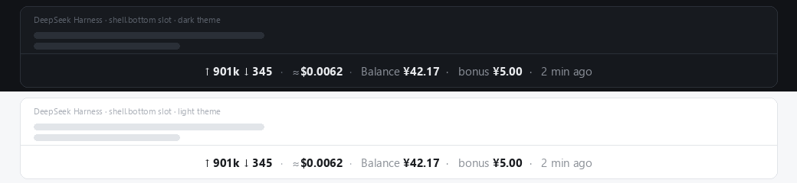

# dsh-balance-strip

A one-line status bar for the [DeepSeek Harness](https://github.com/deepseek-ai/deepseek-harness) Web GUI: **account balance, session token counters, and an estimate of what the session has cost so far** — always visible instead of buried in Settings.



```text
↑ 901k  ↓ 345   ≈$0.0062   ·   Balance ¥42.17   ·   bonus ¥5.00   ·   2 min ago
```

The strip occupies the frame's `shell.bottom` slot — the full-width band underneath the sidebar, conversation, and right panel — so it never covers content and disappears entirely when it has nothing to report.

## What it shows

| Segment | Meaning | Source |
|---|---|---|
| `↑ 901k` | Input tokens of the current session: uncached + cache-read + cache-write | `tokenUsage` session projection |
| `↓ 345` | Output tokens of the current session | `tokenUsage` projection |
| `≈$0.0062` / `≈¥0.044` | Estimated spend of the session, in the wallet's currency | token counts × the model's published price |
| `Balance ¥42.17` | Wallet funds | `account/getBalance` Remote method, polled once a minute |
| `bonus ¥5.00` | Bonus credit, shown only when the wallet has any | same read |
| `2 min ago` | Age of the last successful wallet read | local clock |
| `↻` | Hint that the strip is clickable | — |

Hovering shows the exact numbers, the cache split (`cached 900000`), the model the price came from, and the price basis. Clicking refreshes immediately.

Session counters follow the live projection feed, so they move while the agent works. The wallet is polled once per minute — the Platform returns a snapshot, not a stream.

## Which session

The strip reports on the session the Conversation is showing: switching sessions in the sidebar switches the counters with it. A zero-render occupant of `conversation.session.header.actions` publishes the shown Session id, because the bottom slot itself sits outside the Session scope. When no Session is shown (blank home), the strip falls back to the running session, then to the most recent catalogue row.

## Requirements

- A DeepSeek Harness build with the Web GUI (`dsh web`, or the desktop application). Written and tested against the `0.2.1-rc.5` desktop build.
- The `shell.bottom` slot, `remote.account`, and the `tokenUsage` / `modelSelection` session projections, all of which ship with the standard web composition.
- A signed-in DeepSeek Platform account for the balance part. Token counters and cost work for any provider that reports usage.

## Installation

The plugin is not published on npm; installation is a directory copy plus one Loader row.

### From the DSH plugin market

The plugin is listed in its own market index:

```text
https://raw.githubusercontent.com/aimedweboff-ai/dsh-balance-strip/main/market/index.json
```

In DSH open **Plugins → Discover**, add that URL through **Add index source** (or the market menu's **Manage index sources…**), pick the *aimedweboff-ai plugins* market, and press **Install** on the Balance strip card. Discover needs the `plugin-market` and `ui-plugin-market` rows, which ship with DSH but stay out of the default profile; [`market/README.md`](market/README.md) shows the two-row insert that enables them.

### 1. Copy the package into your profile

```powershell
# Windows (PowerShell)
git clone https://github.com/aimedweboff-ai/dsh-balance-strip.git $env:TEMP\dsh-balance-strip
$profile = "$env:USERPROFILE\.dsh\profiles\desktop"
Copy-Item -Recurse -Force "$env:TEMP\dsh-balance-strip" "$profile\node_modules\dsh-balance-strip"
```

```bash
# macOS / Linux
git clone https://github.com/aimedweboff-ai/dsh-balance-strip.git /tmp/dsh-balance-strip
cp -R /tmp/dsh-balance-strip ~/.dsh/profiles/desktop/node_modules/dsh-balance-strip
```

If your profile lives elsewhere, use that path instead — `DSH_HOME` points at the directory that contains `profiles/`.

### 2. Mount the bundle

The package ships [`cordis.patch.yml`](cordis.patch.yml), so installing it as a bundle registers its Loader row by itself: **Plugins → Add plugin** with the directory, or `plugin_manager` `install_bundle` with the absolute package directory. Nothing else to edit.

A directory copy that was not installed as a bundle needs the row appended to `~/.dsh/profiles/desktop/cordis.patch.yml` (create the file with `[]` when it does not exist), which is exactly what the shipped patch contains:

```yaml
- insert:
    - id: balance-strip
      name: dsh-balance-strip
```

### 3. Restart DeepSeek Harness

Client bundles are read at startup, so a full restart of the application is required — reloading the page is not enough.

### Verify

After the restart the strip appears above the bottom edge of the window once the account is signed in or a session reports usage. If it does not, open **Settings → Plugins** and look for a `dsh-balance-strip` row reporting a load failure; the console also names the missing bundle.

## Update

```powershell
git -C $env:TEMP\dsh-balance-strip pull
Copy-Item -Recurse -Force "$env:TEMP\dsh-balance-strip\*" "$env:USERPROFILE\.dsh\profiles\desktop\node_modules\dsh-balance-strip"
```

Restart afterwards. The `cordis.patch.yml` entry stays as it is.

## Uninstall

Delete `node_modules/dsh-balance-strip` from the profile, remove the `balance-strip` insert from `cordis.patch.yml`, restart.

## Pricing

The cost figure is an estimate from the **official DeepSeek list prices**, each bucket given as off-peak / peak (peak is double), per 1M tokens.

`deepseek-flash`:

| Currency | input (miss) | input (cache hit) | cacheWrite | output |
|---|---|---|---|---|
| USD | 0.15 / 0.30 | 0.003 / 0.006 | 0 | 0.60 / 1.20 |
| CNY | 1 / 2 | 0.02 / 0.04 | 0 | 4 / 8 |

`deepseek-v4-pro`:

| Currency | input (miss) | input (cache hit) | cacheWrite | output |
|---|---|---|---|---|
| USD | 0.66 / 1.32 | 0.022 / 0.044 | 0 | 1.98 / 3.96 |
| CNY | 4.5 / 9 | 0.15 / 0.30 | 0 | 13.5 / 27 |

```text
cost = (uncachedInput × input + cacheRead × cacheRead
        + cacheWrite × cacheWrite + output × output) / 1 000 000
```

**Tariff.** Peak is 01:00–04:00 and 06:00–10:00 UTC, Monday through Friday; every other hour, weekends included, is off-peak at half price. The strip prices the session at the tariff in effect when it renders and names it in the tooltip. Chinese public holidays are not modelled, so a holiday weekday counts as peak.

**Currency.** The spend is shown once per currency the account holds, in wallet order: an account with both wallets reads `≈$0.828 / ¥5.74`, a yuan-only account reads `≈¥5.74`, a dollar-only one `≈$0.828`. Without a wallet read (signed out, or a provider-only setup) the strip falls back to USD.

An unknown model falls back to `deepseek-flash`. The table is intentionally a few lines of code rather than a settings page: change it in place and restart when DeepSeek changes prices. Model ids come from the session's `modelSelection` projection, so switching models mid-session reprices the whole session total — the number is a running estimate, not an invoice.

**Why the estimate can differ from the wallet drop.** `tokenUsage` is one aggregate for the whole session, so the strip cannot split those tokens between peak and off-peak hours; it prices all of them at the current tariff. The wallet also covers every session and every agent run, not just the one on screen.

## How it works

The package has two halves, in the usual DSH shape:

- `lib/index.js` — the host half: a no-op `apply()` so the package shows up as an ordinary Loader row.
- `lib/client.js` — the browser half: declares `dsh.client` in `package.json`, registers one component into the `shell.bottom` slot, and waits for the `slots`, `locale`, `remote.account`, and `sessions` services.

```js
ctx.slots.inject("shell.bottom", () => ctx.slots.register({
  name: "shell.bottom",
  id: "balance-strip",
  order: 10,
  inject: () => ({ copy, readBalance, readUsage, subscribeUsage }),
}, BalanceStrip));
```

Balance comes from `ctx.remote.account.getBalance()` — the same Remote method the Account settings page uses, with the required client metadata (build version, active language, UTC offset). Usage comes from `ctx.sessions.list`: the strip picks the active session, reads its `tokenUsage` projection, and subscribes to the store for live updates. Money is derived locally, so no extra host API is needed.

Copy exists in English, Russian, and Chinese and follows the interface language.

## Limitations

- Cost is an estimate at list prices, not the amount DeepSeek billed. Wallet movements and bonus grants remain authoritative in **Settings → Account**.
- Input tokens include cache reads, so the input figure looks large; cache reads are much cheaper than fresh input, which is why the split is in the tooltip.
- Usage comes from provider reports. A provider that reports none leaves the counters at zero.
- The wallet needs a signed-in Platform account; with a third-party API key the strip shows tokens and cost only.
- The plugin creates no sessions, sends no model requests, and stores nothing.

## Development

```bash
npm test        # node test/smoke.mjs
```

The smoke test loads the bundle through a stub module loader, checks the slot registration, and folds one synthetic session snapshot into the strip's numbers, including the cost arithmetic.

`make-preview.py` regenerates `docs/preview.png` with Pillow.

## License

MIT © 2026 aimedweboff-ai

---

Русская версия: [README.ru.md](README.ru.md)
