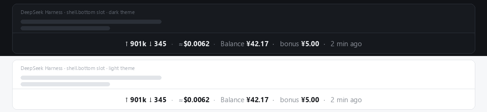

# dsh-balance-strip

Строка состояния для Web-интерфейса [DeepSeek Harness](https://github.com/deepseek-ai/deepseek-harness): **баланс аккаунта, счётчики токенов сессии и оценка её стоимости** — постоянно на виду, а не в глубине настроек.



```text
↑ 901k  ↓ 345   ≈$0.0062   ·   Баланс ¥42.17   ·   бонус ¥5.00   ·   2 мин назад
```

Полоса занимает слот кадра `shell.bottom` — полосу на всю ширину под сайдбаром, чатом и правой панелью. Она ничего не перекрывает и полностью исчезает, когда показывать нечего.

## Что показывает

| Элемент | Значение | Источник |
|---|---|---|
| `↑ 901k` | Входящие токены текущей сессии: без кэша + чтение кэша + запись кэша | проекция `tokenUsage` |
| `↓ 345` | Исходящие токены сессии | проекция `tokenUsage` |
| `≈$0.0062` | Оценка расхода сессии по прайс-листу | счётчики × цена модели |
| `Баланс ¥42.17` | Средства кошелька | Remote-метод `account/getBalance`, опрос раз в минуту |
| `бонус ¥5.00` | Бонусные средства, если они есть | то же чтение |
| `2 мин назад` | Возраст последнего успешного чтения кошелька | локальные часы |
| `↻` | Подсказка, что полоса кликабельна | — |

При наведении — точные числа, доля кэша, модель, по которой посчитана цена, и формула оценки. Клик обновляет немедленно.

Счётчики сессии идут по живому потоку проекций, поэтому меняются во время работы агента. Кошелёк опрашивается раз в минуту: Platform отдаёт снимок, а не поток.

## О какой сессии речь

Полоса показывает ту сессию, которая открыта в чате: переключение сессии в сайдбаре переключает и счётчики. Идентификатор открытой сессии публикует невидимый occupant слота `conversation.session.header.actions` — сам нижний слот находится вне области сессии. Когда сессия не открыта (пустой экран), полоса берёт запущенную сессию, а если таких нет — самую свежую строку списка.

## Требования

- Сборка DeepSeek Harness с Web-интерфейсом (`dsh web` или десктопное приложение). Проверено на десктопной сборке `0.2.1-rc.5`.
- Слот `shell.bottom`, сервис `remote.account` и проекции `tokenUsage` / `modelSelection` — всё это есть в стандартной web-композиции.
- Авторизованный аккаунт DeepSeek Platform для баланса. Счётчики токенов и стоимость работают с любым провайдером, который отдаёт usage.

## Установка

Плагина нет в npm: установка — копирование каталога и одна строка в Loader.

### Из маркета плагинов DSH

Плагин есть в собственном индексе маркета:

```text
https://raw.githubusercontent.com/aimedweboff-ai/dsh-balance-strip/main/market/index.json
```

В DSH откройте **Плагины → Discover**, добавьте этот адрес через **Add index source** (или через меню маркета → **Manage index sources…**), выберите маркет *aimedweboff-ai plugins* и нажмите **Install** на карточке Balance strip. Для Discover нужны строки `plugin-market` и `ui-plugin-market` — они есть в DSH, но не входят в профиль по умолчанию; в [`market/README.md`](market/README.md) показана вставка из двух строк, которая их включает.

### 1. Скопировать пакет в профиль

```powershell
# Windows (PowerShell)
git clone https://github.com/aimedweboff-ai/dsh-balance-strip.git $env:TEMP\dsh-balance-strip
$profile = "$env:USERPROFILE\.dsh\profiles\desktop"
Copy-Item -Recurse -Force "$env:TEMP\dsh-balance-strip" "$profile\node_modules\dsh-balance-strip"
```

```bash
# macOS / Linux
git clone https://github.com/aimedweboff-ai/dsh-balance-strip.git /tmp/dsh-balance-strip
cp -R /tmp/dsh-balance-strip ~/.dsh/profiles/desktop/node_modules/dsh-balance-strip
```

Если профиль лежит в другом месте, подставьте свой путь: `DSH_HOME` указывает на каталог, внутри которого находится `profiles/`.

### 2. Подключить бандл

В пакете есть [`cordis.patch.yml`](cordis.patch.yml), поэтому установка каталога как бандла (**Плагины → Add plugin** или `plugin_manager` `install_bundle` с абсолютным путём к каталогу) сама регистрирует строку Loader. Ничего дописывать не нужно.

Если каталог просто скопирован и бандлом не устанавливался, строку нужно добавить в `~/.dsh/profiles/desktop/cordis.patch.yml` (если файла нет — создать с содержимым `[]`); это ровно то, что лежит в поставляемом патче:

```yaml
- insert:
    - id: balance-strip
      name: dsh-balance-strip
```

### 3. Перезапустить DeepSeek Harness

Клиентские бандлы читаются при старте, поэтому нужен полный перезапуск приложения — перезагрузки страницы недостаточно.

### Проверка

После перезапуска полоса появляется у нижней границы окна, как только аккаунт авторизован или у сессии есть usage. Если её нет — откройте **Настройки → Плагины** и посмотрите строку `dsh-balance-strip`: ошибка загрузки будет видна там, а в консоли — имя недостающего бандла.

## Обновление

```powershell
git -C $env:TEMP\dsh-balance-strip pull
Copy-Item -Recurse -Force "$env:TEMP\dsh-balance-strip\*" "$env:USERPROFILE\.dsh\profiles\desktop\node_modules\dsh-balance-strip"
```

Затем перезапуск. Запись в `cordis.patch.yml` остаётся прежней.

## Удаление

Удалить `node_modules/dsh-balance-strip` из профиля, убрать вставку `balance-strip` из `cordis.patch.yml`, перезапустить.

## Цены

Стоимость — оценка по таблице цен в [`lib/client.js`](lib/client.js), снятой с каталога моделей, который поставляется внутри DSH (`@earendil-works/pi-ai`), в **USD за 1M токенов**:

| Модель | input | cacheRead | cacheWrite | output |
|---|---|---|---|---|
| `deepseek-flash` | 0.30 | 0.006 | 0 | 1.20 |
| `deepseek-v4-pro` | 1.32 | 0.044 | 0 | 3.96 |

```text
cost = (uncachedInput × input + cacheRead × cacheRead
        + cacheWrite × cacheWrite + output × output) / 1 000 000
```

Неизвестная модель считается по ценам `deepseek-flash`. Таблица специально сделана несколькими строками кода, а не страницей настроек: при смене цен её правят на месте и перезапускают приложение. Идентификатор модели берётся из проекции `modelSelection`, поэтому смена модели посреди сессии пересчитывает всю сессию — число остаётся текущей оценкой, а не счётом.

## Как устроено

Две половины, как принято в DSH:

- `lib/index.js` — хост-половина: пустой `apply()`, чтобы пакет выглядел обычной строкой Loader.
- `lib/client.js` — браузерная половина: объявляет `dsh.client` в `package.json`, регистрирует компонент в слоте `shell.bottom` и ждёт сервисы `slots`, `locale`, `remote.account`, `sessions`.

```js
ctx.slots.inject("shell.bottom", () => ctx.slots.register({
  name: "shell.bottom",
  id: "balance-strip",
  order: 10,
  inject: () => ({ copy, readBalance, readUsage, subscribeUsage }),
}, BalanceStrip));
```

Баланс берётся из `ctx.remote.account.getBalance()` — тем же Remote-методом, что и карточка в Настройки → Аккаунт, с обязательными метаданными клиента (версия сборки, язык, смещение UTC). Расход — из `ctx.sessions.list`: полоса выбирает активную сессию, читает проекцию `tokenUsage` и подписывается на хранилище для живых обновлений. Деньги считаются локально, дополнительный хост-API не нужен.

Тексты есть на английском, русском и китайском и следуют языку интерфейса.

## Ограничения

- Стоимость — оценка по прайс-листу, а не списанная сумма. Движения кошелька и бонусы авторитетны в **Настройки → Аккаунт**.
- Входящие включают чтение кэша, поэтому цифра выглядит крупной; кэш намного дешевле свежего ввода — поэтому разбивка в подсказке.
- Usage приходит из отчётов провайдера. Если провайдер их не присылает, счётчики остаются нулевыми.
- Балансу нужен авторизованный аккаунт Platform; со сторонним API-ключом полоса показывает только токены и стоимость.
- Плагин не создаёт сессий, не шлёт запросов к модели и ничего не сохраняет.

## Разработка

```bash
npm test        # node test/smoke.mjs
```

Smoke-тест загружает бандл через заглушку модульного загрузчика, проверяет регистрацию в слоте и считает одну синтетическую сессию, включая арифметику стоимости.

`make-preview.py` перерисовывает `docs/preview.png` через Pillow.

## Лицензия

MIT © 2026 aimedweboff-ai

---

English: [README.md](README.md)
